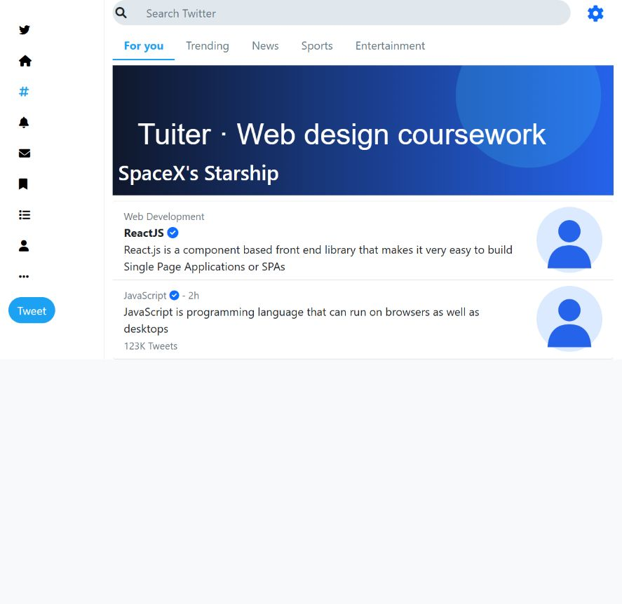
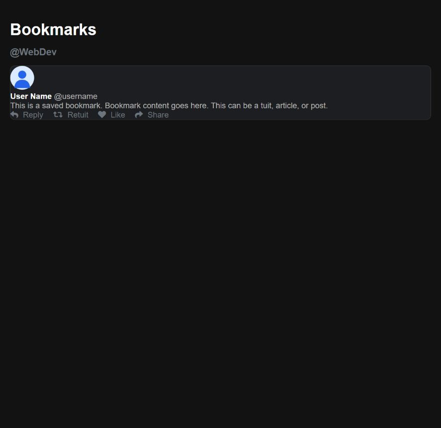

# Tuiter Web Design Coursework

**HTML · CSS · Bootstrap · Responsive interface exercises**

A consolidated archive of semester web-design assignments building a Twitter-inspired interface, from basic HTML pages to CSS and Bootstrap layouts. Multiple recovered stages are grouped into one repository.

*Archived coursework prototype · Not actively maintained*

## Interface showcase





These previews render the recovered HTML/CSS with publication repairs to local asset paths. Personal and uncertain-provenance photos are replaced by neutral SVG placeholders; the layout and sample assignment content are preserved.

## Pages to explore

| Page | Recovered interface |
| --- | --- |
| [Start page](index.html) | Links to available screens |
| [Home](home.html) | Post composer, reply selector, example feed |
| [Explore](explore/index.html) | Search field, topic tabs, responsive columns |
| [Bookmarks](bookmarks/index.html) | Saved-post layout and action placeholders |
| [Profile](profile.html) | Banner, avatar, profile details |
| [Edit profile](edit-profile.html) | Profile form exercise |
| [Compose](tuit.html) | Tuit composer exercise |

## Run locally

No Node installation or build step is needed:

```bash
python -m http.server 8000 --bind 127.0.0.1
```

Open `http://127.0.0.1:8000/`. Bootstrap and Font Awesome are linked through their CDNs. On GitHub, HTML links show source; use the local server to interact with the pages.

## Preserved versions

[coursework-versions.zip](coursework-versions.zip) groups the recovered HTML basics, CSS, Bootstrap, updated HTML, loose-page, and numbered-folder variants. Repeated ZIP copies and the case-only duplicate A3 directory are omitted. The directly browsable pages use the Bootstrap stage, with missing composer/edit screens retained from another recovered stage.

[Source notes](SOURCE_NOTES.md) list the archived files and publication repairs. The exercises follow course assignment briefs; instructor handouts remain in the local course-material collection and are not republished here as project code.

## Status

These are static interface exercises. Search, posting, likes, follow controls, and account actions are placeholders; no backend, authentication, or persistent social feed was recovered. Some historical action links refer to unimplemented screens. The registration backend found nearby is a separate Flask project.
